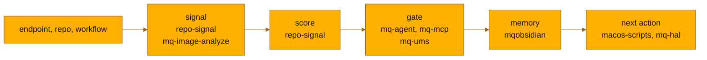
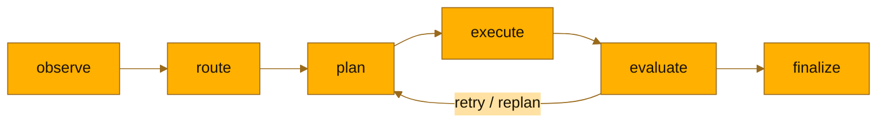

# Mattias Camner

IT architect in Stockholm. I build local, reviewable tools for repository
health, governed AI operations and endpoint work, mostly in the terminal.

[Journal](https://mcamner.github.io/mcamner-journal/) ·
[LinkedIn](https://www.linkedin.com/in/mattias-camner-75958022)

<a href="https://github.com/MCamner/macos-scripts">
  <picture>
    <source media="(prefers-color-scheme: dark)" srcset="docs/screenshots/hal-brief-dark.png">
    
  </picture>
</a>

Real output from <code>mqlaunch hal brief</code>, the status view in
<a href="https://github.com/MCamner/macos-scripts">macos-scripts</a>.

## Start here

* **[mq-agent](https://github.com/MCamner/mq-agent#quick-start)**: the core of
  the MQ stack. Workflows, reviews and release gates with verification receipts.
* **[macos-scripts](https://github.com/MCamner/macos-scripts#quick-start)**:
  the terminal entrypoint to the stack, through `mqlaunch`.
* **[Atlas Core](https://mcamner.github.io/atlas-core/)**: a standalone loop
  engine for routed, evaluated, retryable AI-assisted work.

## The MQ stack

Every MQ tool follows the same loop: make state visible, score it, gate the
action, and keep what was learned.

| Repository | Role |
|---|---|
| [`mq-agent`](https://github.com/MCamner/mq-agent) | Orchestrates workflows, reviews, release gates, and repo-owned checks with code-bound verification receipts |
| [`macos-scripts`](https://github.com/MCamner/macos-scripts) | Terminal entrypoint and local workflow toolkit |
| [`mqobsidian`](https://github.com/MCamner/mqobsidian) | Durable technical memory, reviewed decisions, and compact agent context |
| [`mq-mcp`](https://github.com/MCamner/mq-mcp) | Policy-bound MCP runtime for controlled tool execution |
| [`repo-signal`](https://github.com/MCamner/repo-signal) | Structural readiness scores, kept separate from verification evidence, and structured AI context |
| [`mq-hal`](https://github.com/MCamner/mq-hal) | Operator views for repo, stack, release, runtime, and changed-file verification, with safe command routing |
| [`mq-image-analyze`](https://github.com/MCamner/mq-image-analyze) | Extracts operational signal from screenshots and UI states |
| [`mq-ums`](https://github.com/MCamner/mq-ums) | Gated operator surface for IGEL UMS workflows |

A high structure score is not proof that tests passed: verification evidence is
reported as `PASS`, `FAIL`, `STALE` or `NOT_VERIFIED`, separately from scores.
See the [repo-signal verification contract](https://github.com/MCamner/repo-signal/blob/main/docs/DOCTOR_SCHEMA.md#verification-evidence-additive).

[Full MQ ecosystem](docs/MQ_ECOSYSTEM.md) · [Operating model](docs/OPERATING_MODEL.md)

## Outside MQ

[**Atlas Core**](https://github.com/MCamner/atlas-core) is a bounded task loop,
kept separate from the MQ stack on purpose: MQ, GitHub and memory plug in as
adapters, not as the core. Experimental.

[Site](https://mcamner.github.io/atlas-core/) · [Wiki](https://github.com/MCamner/atlas-core/wiki)

The [Journal](https://mcamner.github.io/mcamner-journal/) is where I write about
systems, technology and thinking.

## Endpoint tools

Browser-based readiness checks for endpoints, with an optional read-only local
helper: [browser check](https://mcamner.github.io/MCamner/client-readiness-check.html) ·
[Diagnostics v2](https://mcamner.github.io/MCamner/client-readiness-v2.html) ·
[helper guide](helper/README.md).

---

[Project notes](docs/PROJECTS.md) · [Security and public-data policy](docs/SECURITY.md)
