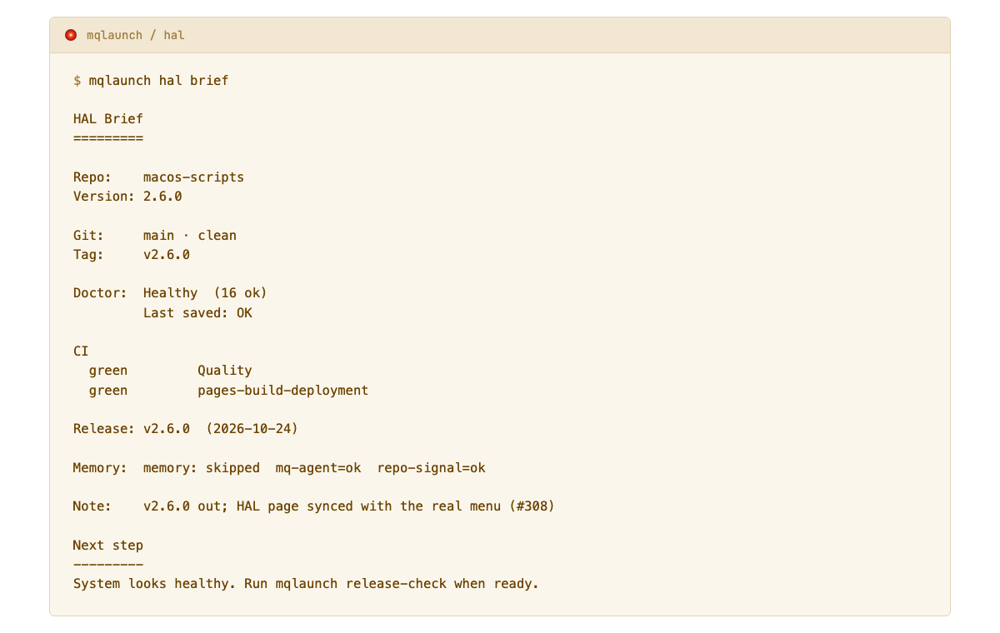
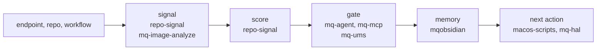
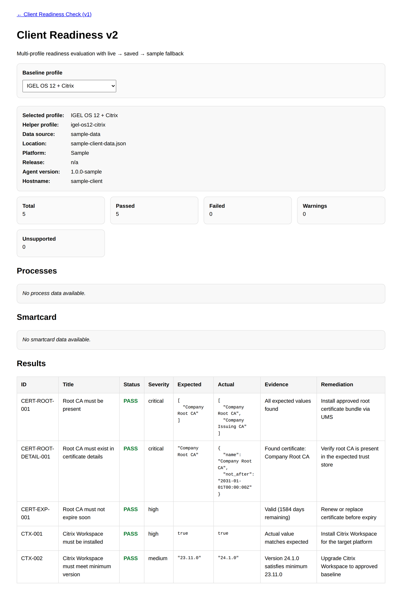

# Mattias Camner

IT architect in Stockholm. I build local, reviewable tools for endpoint
readiness, repository health and governed AI operations, mostly in the terminal.

[Journal](https://mcamner.github.io/mcamner-journal/) ·
[LinkedIn](https://www.linkedin.com/in/mattias-camner-75958022) ·
[Black Iris](https://blackiris.se/)

<a href="https://github.com/MCamner/macos-scripts">
  <picture>
    <source media="(prefers-color-scheme: dark)" srcset="docs/screenshots/hal-brief-dark.png">
    
  </picture>
</a>

Real output from <code>mqlaunch hal brief</code>, the status view in
<a href="https://github.com/MCamner/macos-scripts">macos-scripts</a>.

## Start here

* **[Run the browser readiness check](https://mcamner.github.io/MCamner/client-readiness-check.html)**:
  validate an endpoint in the browser, no install.
* **[Open Diagnostics v2](https://mcamner.github.io/MCamner/client-readiness-v2.html)**:
  profile-based evaluation with evidence behind every result.
* **[Install macos-scripts](https://github.com/MCamner/macos-scripts#quick-start)**:
  the terminal entrypoint to the MQ stack.

## The MQ stack

Every tool follows the same loop: make state visible, score it, gate the
action, and keep what was learned.

| Repository | Role |
|---|---|
| [`macos-scripts`](https://github.com/MCamner/macos-scripts) | Terminal entrypoint and local workflow toolkit |
| [`mq-hal`](https://github.com/MCamner/mq-hal) | Operator views for repo, stack, release, runtime, and changed-file verification, with safe command routing |
| [`mq-agent`](https://github.com/MCamner/mq-agent) | Orchestrates workflows, reviews, release gates, and repo-owned checks with code-bound verification receipts |
| [`mq-mcp`](https://github.com/MCamner/mq-mcp) | Policy-bound MCP runtime for controlled tool execution |
| [`mqobsidian`](https://github.com/MCamner/mqobsidian) | Durable technical memory, reviewed decisions, and compact agent context |
| [`repo-signal`](https://github.com/MCamner/repo-signal) | Structural readiness scores, kept separate from verification evidence, and structured AI context |
| [`mq-image-analyze`](https://github.com/MCamner/mq-image-analyze) | Extracts operational signal from screenshots and UI states |
| [`mq-ums`](https://github.com/MCamner/mq-ums) | Gated operator surface for IGEL UMS workflows |

A high structure score is not proof that tests passed: verification evidence is
reported as `PASS`, `FAIL`, `STALE` or `NOT_VERIFIED`, separately from scores.
See the [repo-signal verification contract](https://github.com/MCamner/repo-signal/blob/main/docs/DOCTOR_SCHEMA.md#verification-evidence-additive).

[Full MQ ecosystem](docs/MQ_ECOSYSTEM.md) · [Operating model](docs/OPERATING_MODEL.md)

## Client readiness in practice

The public demo evaluates endpoint signals against explicit profiles, shows the
evidence behind every result, and suggests remediation that support or
operations can review.

| Mode | What it can inspect | Best for |
|---|---|---|
| Browser-only | Browser, secure context, display, locale, timezone, and basic endpoint reachability | Fast first-line validation with no installation |
| Browser + read-only helper | OS, network, certificates, smartcard, Citrix, management signals, and named baselines | Deeper diagnostics and repeatable operational evidence |

The page falls back to browser-only checks when the helper is unavailable. See
the [helper setup and deployment guide](helper/README.md).

---

[Project notes](docs/PROJECTS.md) · [Security and public-data policy](docs/SECURITY.md)
